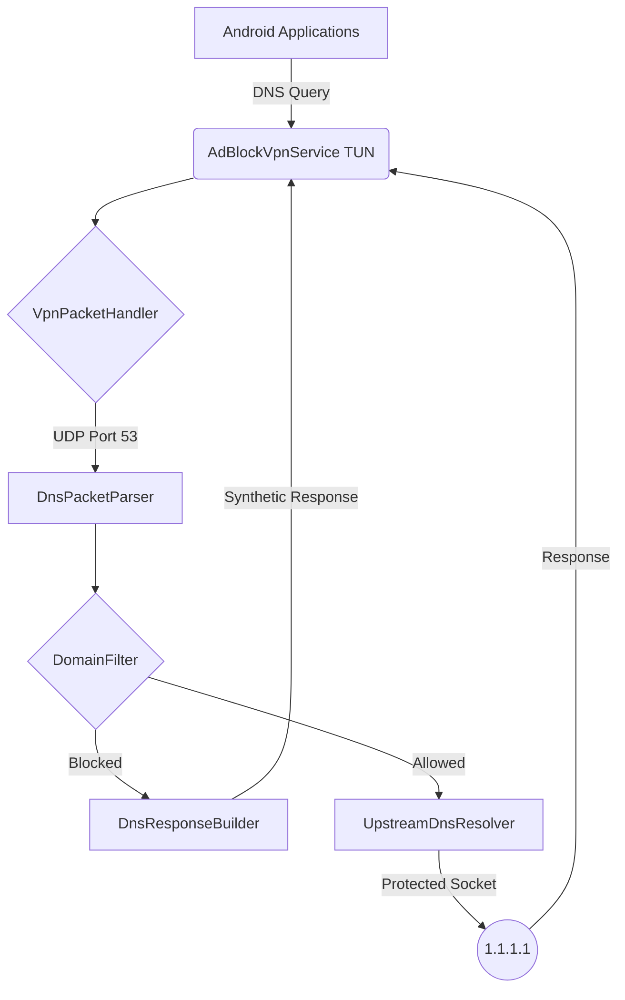
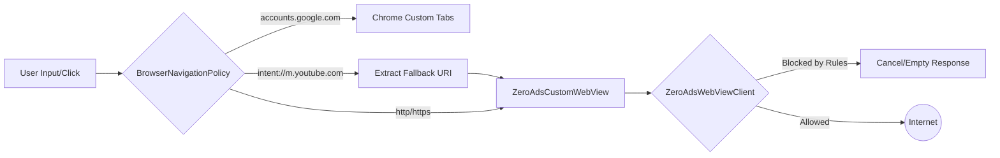

# ZeroAds

> **Notice:** Development is temporarily paused. The current source code and project documentation are retained for future continuation when sufficient testing hardware and resources are available.

ZeroAds is an Android privacy-oriented application developed using Kotlin and Jetpack Compose. Its goal is to provide a unified environment for ad-free browsing and network-wide privacy.

## Capabilities Overview
- Local DNS-based advertisement and tracker blocking via Android `VpnService`.
- A general-purpose Android web browser ("ZeroAds Nebula").
- Isolated YouTube-specific functionality (ad skipping, sponsor blocking, background media playback).
- WireGuard-based secure VPN integration architecture (coordinating between local-only DNS and full remote tunneling).
- Privacy-focused networking utilizing strict domain filtering and intent routing.

---

## 🛠 Technology Stack

- **Language:** Kotlin
- **UI Framework:** Jetpack Compose (Material 3)
- **Networking/VPN:** Android `VpnService`, `com.wireguard.android:tunnel:1.0.20260102`
- **Web Engine:** Android `WebView`, AndroidX `WebKit` (`1.18.0`)
- **Authentication:** AndroidX `Browser` (Chrome Custom Tabs, `1.8.0`)
- **Persistence:** Jetpack `DataStore` Preferences (`1.1.1`), `kotlinx-serialization-json` (`1.7.3`)
- **Background Media:** Android `MediaSession` APIs
- **Build System:** Gradle (Target SDK 37, Min SDK 26)

---

## 🏗 Architecture

### A. DNS Protection
The core of ZeroAds relies on intercepting traffic via a local `VpnService` to provide system-wide ad-blocking without requiring a rooted device.

1. **`AdBlockVpnService.kt`**: Establishes the VPN TUN interface and routing.
2. **`VpnPacketHandler.kt` & `IPv4PacketProcessor.kt`**: Reads raw byte arrays from the interface and decodes IPv4 headers.
3. **`DnsPacketParser.kt`**: Identifies UDP packets on Port 53 and decodes the DNS queries.
4. **`DomainFilter.kt` & `BlocklistManager.kt`**: Checks the requested domain against a locally parsed blocklist.
5. **`DnsResponseBuilder.kt`**: If a domain is blocked, a synthetic "NXDOMAIN" or "0.0.0.0" response is generated and routed back to the client.
6. **`UpstreamDnsResolver.kt`**: If permitted, the request is forwarded via a protected socket (bypassing the VPN) to an upstream resolver (e.g., `1.1.1.1`).



### B. ZeroAds Browser (Nebula)
A fully functional, multi-tab browser designed to integrate tightly with the ad-blocking rules while preventing Google/YouTube tracking.

- **`ZeroAdsBrowserScreen.kt` & `ZeroAdsBrowserViewModel.kt`**: Manages multiple `TabState` instances, UI rendering, history, and bookmarks.
- **`ZeroAdsCustomWebView.kt`**: Extends `WebView` to manage touch events, focus logic for the Android keyboard, and background playback capabilities.
- **`ZeroAdsWebViewClient.kt`**: Handles SSL errors, URL overriding, and integrates with `ZeroAdsRuleManager` for browser-level filtering.
- **`DocumentStartScriptBuilder.kt`**: Injects JavaScript *strictly* into validated `youtube.com` domains to handle SponsorBlock, ad-skipping, and media-session bridging.
- **`BrowserNavigationPolicy.kt`**: Acts as the gatekeeper for intents (`intent://`, `vnd.youtube://`) to prevent native applications (like the official YouTube app) from hijacking the session.



### C. Secure VPN / WireGuard
ZeroAds integrates the official WireGuard library to support transitioning from local-only DNS filtering to a full-device encrypted tunnel.

- **`VpnCoordinator.kt`**: Ensures that the local `AdBlockVpnService` and the `WireGuardManager` do not compete for the single allowed Android VPN interface.
- **`WireGuardManager.kt`**: Uses `GoBackend` to parse standard `.conf` files and establish UDP tunnels to remote VPS endpoints.

**Note on WireGuard Status:**
While the architecture to import configurations and swap VPN modes is implemented, **no valid remote WireGuard profile was provisioned or tested during the latest validation phase.** The remote tunnel functionality is currently *unverified*.

---

## 📊 Implemented Features Status

| Category | Feature | Status |
| :--- | :--- | :--- |
| **DNS** | Local DNS filtering | ✅ Tested |
| **DNS** | Blocklist parsing & matching | ✅ Tested |
| **DNS** | Synthetic DNS Responses | ✅ Tested |
| **DNS** | VPN Lifecycle Management | ✅ Tested |
| **Browser** | General WebView browsing | ✅ Tested |
| **Browser** | Multi-tab architecture | ✅ Tested |
| **Browser** | Bookmarks & History (DataStore) | ✅ Tested |
| **Browser** | Android Keyboard (IME) handling | ✅ Tested |
| **Browser** | YouTube script isolation | ✅ Tested |
| **Browser** | Background Audio Playback | ✅ Tested |
| **Browser** | Google Auth Handoff (Custom Tabs)| ✅ Tested |
| **Browser** | Downloads (DownloadManager) | ⏳ Partially implemented (Enqueues only) |
| **VPN** | WireGuard Dependency Integration | ✅ Implemented |
| **VPN** | Configuration Parsing & UI | ✅ Implemented |
| **VPN** | Secure Tunnel connection | ❌ Not verified (Requires VPS) |
| **VPN** | IPv6/DNS Leak Protection | ❌ Not verified |

---

## ⚠️ Known Limitations & Unresolved Issues

1. **YouTube Navigation (Signed-In):** Logged-out YouTube playback functions perfectly inside the ZeroAds WebView. However, when signed into a Google account, YouTube occasionally injects deep links (`intent://`) that attempt to launch the native Android YouTube application. While `BrowserNavigationPolicy` was implemented to trap these intents, the signed-in behavior remains **unverified** in the final physical device test.
2. **Google Authentication Sessions:** Google restricts OAuth inside embedded WebViews (`403 disallowed_useragent`). ZeroAds successfully hands off authentication to Chrome Custom Tabs. However, because Custom Tabs and the local WebView maintain separate cookie jars, signing in via Custom Tabs does *not* automatically authenticate the user inside the ZeroAds WebView.
3. **WireGuard Connectivity:** The application can parse WireGuard configs, but actual full-tunnel routing and DNS leak prevention through a remote endpoint have not been physically verified.
4. **Browser State Persistence:** Tabs do not survive a cold reboot of the application (only History and Bookmarks are persisted).
5. **Downloads:** The browser successfully passes URLs to Android's `DownloadManager`, but lacks an internal UI for managing/viewing completed downloads.

---

## 🚀 Future Development Roadmap

For developers resuming this project, the following phases are recommended:

**Phase 1 — Browser Stability**
- Definitively resolve the signed-in YouTube native-app redirect via exhaustive intent trapping.
- Investigate Cookie synchronization or alternative safe OAuth flows to bridge the Custom Tabs / WebView session gap.
- Implement tab state persistence (saving active URLs to DataStore).
- Build a dedicated Downloads UI.

**Phase 2 — WireGuard Integration**
- Provision a real Ubuntu VPS with WireGuard and AdGuard Home (refer to `/scripts/vps/setup_wireguard_vps.sh`).
- Import the `.conf` file into ZeroAds and verify tunnel establishment.
- Verify IPv4 routing and implement complete IPv6 leak protection.

**Phase 3 — Combined Privacy Architecture**
- Finalize "Mode C" (Secure Tunnel + Ad Blocking). Verify that DNS requests securely route to the VPS resolver without leaking to the local ISP.
- Implement Android "Always-On VPN" and application-level kill-switch behaviors.
- Validate network handoffs (Wi-Fi <-> Mobile Data).

---

## 💻 Installation & Build Instructions

### Prerequisites
- Android Studio Ladybug (or newer)
- JDK 17
- Physical Android Device (Android 8.0 / API 26 minimum)

### Build & Install

```bash
# Run unit tests (ensures DNS baseline and intent policies are intact)
./gradlew clean test

# Build the Debug APK
./gradlew assembleDebug

# Install on connected device via ADB
adb install -r app/build/outputs/apk/debug/app-debug.apk
```

---

## 📁 Project Structure

```text
ZeroAds/
├── app/
│   ├── build.gradle.kts
│   └── src/
│       ├── main/
│       │   ├── AndroidManifest.xml
│       │   └── java/com/zeroads/blocker/
│       │       ├── dns/                 # Local DNS processing & Blocklists
│       │       ├── vpn/                 # Android VpnService & Packet Handlers
│       │       ├── ui/theme/            # Jetpack Compose UI & Dashboard
│       │       ├── ZeroAdsBrowserScreen.kt
│       │       ├── BrowserNavigationPolicy.kt
│       │       ├── VpnCoordinator.kt
│       │       └── WireGuardManager.kt
│       └── test/                        # Unit and Integration Tests
├── scripts/
│   └── vps/
│       ├── ARCHITECTURE_DECISION_RECORD.md
│       └── setup_wireguard_vps.sh       # Remote VPN setup script
└── README.md
```

---

## 🛡 Security & Privacy Notice

- **Baseline Preservation:** The core DNS and VPN packet parsing algorithms (`app/src/main/java/com/zeroads/blocker/dns/*` and `vpn/*`) are cryptographically verified against `dns_baseline_checksums.txt`. Do not alter these files without regenerating and documenting the baseline.
- **Keys & Configurations:** ZeroAds does not hardcode VPN private keys. WireGuard configurations must be provided by the user and are stored locally.
- **Bridge Security:** The `ZeroAdsBridge` (native JavascriptInterface) is strictly validated against `*.youtube.com` origins to prevent arbitrary websites from executing native app commands (like media play/pause).
- **SSL Certificates:** The application safely rejects SSL errors (`onReceivedSslError`) and does not bypass certificate validation.

---
*End of documentation. Proceed to Phase 1 when resources permit.*
